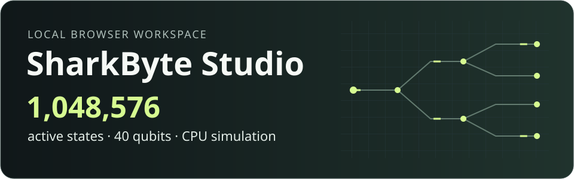

# SharkByte



SharkByte is an experimental programming language and CPU simulation toolchain. Write and run `.sb` programs in a local browser workspace or from the terminal, inspect the results, and save JSON receipts with the exact source.

[Start Studio](#sharkbyte-studio) · [Try error correction](#five-qubit-phase-flip-recovery) · [See the 16-million-state results](#scaling-to-16777216-active-states) · [Cite SharkByte](#cite-sharkbyte)

| What to try | Where it runs | What you can reproduce |
| --- | --- | --- |
| Phase-flip recovery | Studio, Quantum mode | Five qubits and eleven cases, including single-error recovery and two-error failure controls |
| Million-state benchmark | Studio, built-in preset | 40 qubits, 52 gates, and 1,048,576 active states. A browser-launched run took 3.020 s of CPU evolution. |
| 16-million-state benchmark | Terminal, standalone sparse runner | 40 qubits, 56 gates, and 16,777,216 active states on Windows ARM64 and Ubuntu WSL2 |

## SharkByte Studio

Download and extract the GitHub source ZIP or clone the repository. From the checkout, use Python 3.10 or later:

| Platform | Command |
| --- | --- |
| Windows PowerShell | `python -B sharkbyte_studio.py` |
| Linux or WSL | `python3 -B sharkbyte_studio.py --no-browser` |

Open [http://127.0.0.1:8120/](http://127.0.0.1:8120/). Studio listens on your own computer. Keep the terminal running and press Ctrl+C to stop it. If the port is busy, pass `--port 8121` and open the URL printed by the launcher.

| Mode | What it runs |
| --- | --- |
| Classical | SharkVM, with a 50,000,000-instruction limit |
| Quantum | CPU statevector simulation for circuits with 1–6 qubits, including the recovery presets |
| Bounded Hybrid | Experimental quantum circuits with classical feedback and limited adaptive updates, using 2–6 qubits |
| Frontier30 (sparse) | Fixed quantum circuits with registers up to 40 qubits. Select a support cap from 4,096 to 131,072 active states. |
| Million-state benchmark | Bundled 40-qubit scaling case with a compact 1,048,576-state result |

Choose **Load example** or paste source, then select **Run**. Studio shows output, metrics, the source used for the run, and SharkVM bytecode when available. The sparse mode previews large probability tables and **Save receipt** downloads the full JSON directly from the local server. Frontier30 returns probabilities. Standard Quantum mode can also report sampled counts. The [30-qubit GHZ example](examples/ghz_phase_30.sb) fits the default sparse cap, and the bundled Frontier30 example selects 131,072 automatically.

Verify downloads with `python -m sharkbyte_alpha verify-run FILE.json` (`python3` on Linux). Hash verification checks record integrity. Replay and reference comparisons address reproducibility and numerical correctness separately.

Try `rx 1.5707963267948966 0;`, `ry -.5 0;`, or `rz .25 0;` inside a
Quantum or Frontier30 circuit. Bounded Hybrid also accepts a bound angle such as
`ry theta 0;`. Reproduce the local analytical checks with
`python -B tools/rotation_gate_evidence.py`.
[Grammar](GRAMMAR.md) · [Local rotation evidence](evidence/rotation_gate_local.json)

### Five-qubit phase-flip recovery

Choose **Quantum → Load phase-flip recovery → Run**. The [circuit](examples/phase_flip_recovery.sb) encodes a logical superposition with relative phase +π/3, extracts two parity bits, and applies coherent correction before the final measurement. Outcome strings start with the ancillas `q4 q3`, followed by the decoded data bits.

| Case | Syndrome | Expected probability of decoded data `000` |
| --- | --- | ---: |
| No error, recovery on | `00` | 100% |
| Single Z on q0, q1, or q2, recovery on | `01`, `11`, or `10` | 100% |
| Single Z on q0, q1, or q2, recovery off | `01`, `11`, or `10` | 0% |
| Z on q1, input phase −π/3, check fixed at +π/3 | `11` | 25% |
| Two Z errors, recovery on | `10` for q0+q1, `11` for q0+q2, `01` for q1+q2 | 25% |

**Load two-error control** injects Z on q1 and q2. Its syndrome matches a single error on q0, so the decoder flips q0 and leaves a logical X. The wrong-phase and two-error controls each returned `000` in 247 of 1,024 shots, consistent with 25% overlap for this input. The recovery cases returned `000` in all 1,024 shots each. The results describe ideal simulated gates, this logical input, and the specified injected errors.

[All eleven receipts and their exact circuits](evidence/phase_flip_recovery_cases.json) · Reproduce with `python -B tools/phase_flip_recovery_cases.py`.

Studio also includes an interactive **Phase-flip noise sweep**. It shows the exact expected decoded-`000` probability under an independent per-data-qubit Z channel, comparing one unencoded qubit with the three-qubit code and ideal recovery. For this logical input, zero or one error is corrected exactly; two or more errors leave a 25% decoded-`000` overlap. Thus the curves are `1 − 0.75p` (unencoded) and `1 − 0.75(3p² − 2p³)` (encoded). This is an analytical channel model, not gate-by-gate noise, noisy readout, finite-shot sampling, or a claim about hardware.

## Sparse simulation benchmarks

Active states are the basis states tracked at once. Register width and active state count measure different things. A dense array for 40 qubits would occupy 16 TiB at 16 bytes per complex amplitude. The circuits below use sparse storage and run on a CPU.

### Experimental sparse scaling to 1,048,576 active states

In Studio, choose **Million-state benchmark → Run**. The runner appends the three Hadamards listed in the receipt to the source shown in the editor. The recorded browser-launched run reached **1,048,576 active states in 3.020 s** of sparse evolution on Windows ARM64. [Browser receipt](benchmarks/sb_quantum_benchmark/million-state-browser-receipt.json)

The terminal measurements use this same 40-qubit circuit family, with additional Hadamards to grow its support. Times cover sparse evolution. Windows peak working set was observed by polling the runner process.

| Active states | Gates | Windows ARM64 evolution | Runner peak |
| ---: | ---: | ---: | ---: |
| 131,072 | 49 | 0.210 s | 46.5 MiB |
| 262,144 | 50 | 0.647 s | 70.6 MiB |
| 524,288 | 51 | 0.906 s | 110.4 MiB |
| 1,048,576 | 52 | 2.033 s | 195.8 MiB |
| 2,097,152 | 53 | 2.768 s | 369 MiB |
| 4,194,304 | 54 | 5.988 s | 723 MiB |
| 8,388,608 | 55 | 11.095 s | 1.39 GiB |

[2-million run data](benchmarks/sb_quantum_benchmark/scaling-2097152.json) · [4-million run data](benchmarks/sb_quantum_benchmark/scaling-4194304.json) · [8-million run data](benchmarks/sb_quantum_benchmark/scaling-8388608.json)

### Scaling to 16,777,216 active states

The terminal runner completed the **40-qubit, 56-gate** experiment on both platforms. Each run checked state count, probability normalization, and agreement with the expected uniform probabilities.

| Environment | Python | Sparse evolution | Runner process memory | Evidence |
| --- | --- | ---: | ---: | --- |
| Windows ARM64 | 3.12.10 | 17.614 s | 2.77 GiB peak working set | [Windows JSON](benchmarks/sb_quantum_benchmark/scaling-16777216.json) |
| Ubuntu ARM64 under WSL2 | 3.14.4 | 15.639 s | 2.78 GiB peak RSS | [Ubuntu JSON](benchmarks/sb_quantum_benchmark/scaling-16777216-ubuntu-wsl.json) |

The Ubuntu process ran with a 3.06 GiB address-space limit. These are single local measurements and use different OS memory counters. The 16-million-state runner prints a compact summary. Studio supports the separate million-state preset and full probability receipts through 131,072 active states.

```text
python -B benchmarks/sb_quantum_benchmark/support_scaling.py 16777216
```

## Terminal quickstart

From the checkout, run `python -B sharkbyte_terminal.py` (`python3` on Linux). Try `/help`, `/bell`, `/bell-phase`, or `/qft`. The QFT example embeds a six-qubit transform in a 30-qubit register. Use `/run FILE.sb` for a custom quantum circuit, or `/run-frontier FILE.sb` for a sparse circuit at the default cap.

Save a result with `/save result.json`, check it with `/verify result.json`, and rerun compatible circuit receipts with `/replay result.json`. Quote paths with spaces. Floating-point results can vary across platforms.

### Enable local NPU chat on Windows ARM64

For optional chat, install [Qualcomm GenieX](https://geniex.aihub.qualcomm.com/en/get-started/what-is-geniex) and run from the checkout:

```powershell
geniex --skip-update pull qualcomm/Qwen3-0.6B:W4A16 --model-hub aihub
.Open-SharkByte-AI.ps1 -Terminal
```

The launcher uses Qualcomm's precompiled model weights and connects via loopback. Check live GenieX runtime status to confirm the device used for inference. The circuit and VM commands run independently on the CPU. For custom paths, see the [launcher parameters](Open-SharkByte-AI.ps1).

## Install

Use CPython 3.10+ and pip. The CLI has no external runtime dependencies. Studio runs from the source checkout.

```text
python -m pip install .
sharkbyte doctor
sharkbyte run examples/example.sb --backend vm
sharkbyte run examples/bell.sb --mode quantum
sharkbyte run examples/adaptive.sb --mode hybrid --backend vm
sharkbyte qasm examples/bell.sb --output bell.qasm
sharkbyte verify-run examples/drawdown_risk_demo_overflow_guard.receipt.json
```

The OpenQASM 3 exporter covers the documented circuit subset. See [installation and offline builds](INSTALL.md), [language grammar](GRAMMAR.md), and [calculation limits](docs/CALCULATION_CAPABILITIES.md). The [research examples](docs/RESEARCH_GAP_CALCULATIONS.md) include finite calculations in the language. The [drawdown example](examples/drawdown_risk_demo.sb) is a fixed-point VM demonstration.

## Reproduce the public benchmarks

- [Frontier30 reference suite](benchmarks/sb_quantum_benchmark/) checks analytical amplitudes under a 4,096-state cap and verifies refusal when a gate would exceed it. [GitHub Actions](.github/workflows/ci.yml) runs this suite. The 16-million-state measurements above came from local runs.
- The same Windows and Ubuntu CI matrix runs the [eleven phase-flip recovery cases](tools/phase_flip_recovery_cases.py) and uploads each platform's JSON receipts as a workflow artifact. The committed [reference receipts](evidence/phase_flip_recovery_cases.json) remain directly reproducible from the command above.
- [Backend agreement](benchmarks/backend_agreement/README.md) compares SharkVM, the native interpreter, and Direct AArch64 on Linux ARM64. [The recorded reference check](https://github.com/reggaesharkk/SharkByte/commit/0beed08fc99235d8de1f594448dfa7fc80a46c08) passed 27 cases. Native execution remains disabled in the public CLI and Studio.
- [Qiskit reference provenance](QISKIT_PROVENANCE.md) describes the archived comparisons for 22 circuits and 320 probabilities. Run `python tools/replay_qiskit_vectors.py` to compare those archived reference values.
- [Acceptance scope](PUBLIC_STAGE_ACCEPTANCE.md) · [Claim boundaries](CLAIM_BOUNDARIES.md) · [System map](ECOSYSTEM_MAP.md) · [Reggae Shark Universe](https://github.com/reggaesharkk/Reggae-shark-universe-)

## Cite SharkByte

| Cite | Zenodo DOI |
| --- | --- |
| SharkByte across all versions | [10.5281/zenodo.24213558](https://doi.org/10.5281/zenodo.24213558) |
| Studio source snapshot with the million-state browser receipt | [10.5281/zenodo.24246003](https://doi.org/10.5281/zenodo.24246003) |
| Original standalone alpha 0.2.1a2 | [10.5281/zenodo.24213559](https://doi.org/10.5281/zenodo.24213559) |

The Studio archive freezes commit [18e4eae](https://github.com/reggaesharkk/SharkByte/commit/18e4eae2463eef9c768f15c0818963337456d9a6). For the later phase-flip controls and 16-million-state runs, cite the applicable GitHub revision and evidence file. Current first-party source and the Studio archive use [Apache 2.0](LICENSE). The earlier Zenodo alpha remains MIT. See [license history](LICENSE_STATUS.md) and [third-party notices](THIRD_PARTY_NOTICES.md).
